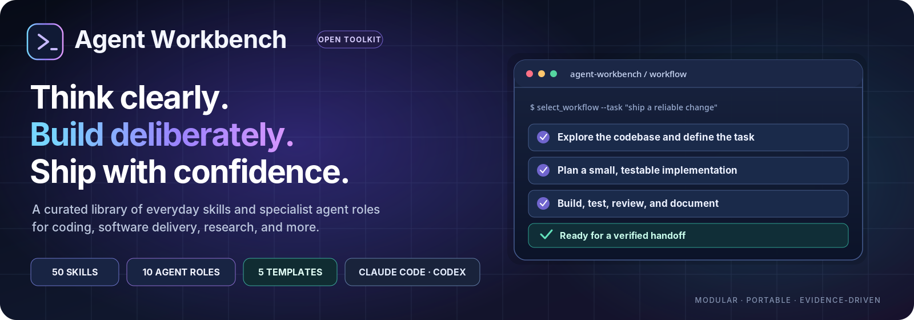
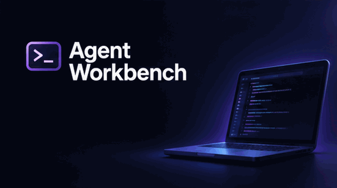
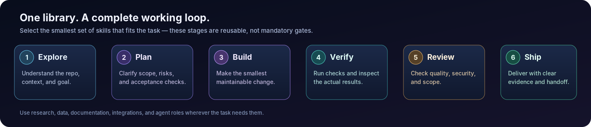

<div align="center">
  
  <p><strong>Think clearly. Build deliberately. Ship with confidence.</strong></p>
  <p>A curated, portable skill library for AI coding agents — spanning everyday engineering, software delivery, research, and specialist agent workflows.</p>
  <p>
    
    
    
    <a href="LICENSE"></a>
    <a href="https://agentskills.io/"></a>
  </p>
  <p>
    <a href="#install-skills">Get started</a> ·
    <a href="#skill-library">Explore skills</a> ·
    <a href="SOURCES.md">Source map</a> ·
    <a href="SKILL_CATALOG.md">More skill libraries</a>
  </p>
</div>

## See the workflow

<div align="center">
  <a href="assets/agent-workbench-overview.mp4">
    
  </a>
  <p><sub>Short illustrative animation — not a recording of the software. Click the preview to open the MP4 version.</sub></p>
  
</div>

Agent Workbench brings together independently written, focused skills and portable role cards for Claude Code, Codex, and compatible agent environments. Use only the workflows a task needs: explore a codebase, clarify requirements, implement a change, verify the result, research a question, or prepare a clear handoff.

It is a curated multi-source project, **not a mirror or bulk import**. Each skill has a defined purpose and activation boundary. The source map records the repositories that informed the collection; no upstream `SKILL.md` files or third-party scripts are vendored. See [SOURCES.md](SOURCES.md) for attribution and license notes, and [SKILL_CATALOG.md](SKILL_CATALOG.md) for additional projects worth exploring.

## What is included

- **50 focused skills** using the Agent Skills `SKILL.md` format.
- **10 portable agent role cards** for common coding and research work. These are role blueprints, not auto-installed vendor-specific agent configs.
- **5 practical templates** for specs, plans, handoffs, experiments, and paper notes.
- A standard-library Python validator, overlap report, and unit tests.

## Skill library

### Core engineering

| Skill | Use it for |
|---|---|
| [`engineering-principles`](skills/engineering-principles/SKILL.md) | planning or changing software; keep trivial edits proportionate. |
| [`codebase-recon`](skills/codebase-recon/SKILL.md) | the task touches code whose architecture, conventions, or test setup are not already clear. |
| [`design-interview`](skills/design-interview/SKILL.md) | multiple plausible interpretations or trade-offs materially affect implementation. |
| [`spec-writing`](skills/spec-writing/SKILL.md) | a durable spec is needed before implementation or ticketing. |
| [`implementation-planning`](skills/implementation-planning/SKILL.md) | Plan a multi-step change before editing. Use for work with multiple files, dependencies, migration risk, or non-obvious verification; skip for trivial fixes. |
| [`ticket-breakdown`](skills/ticket-breakdown/SKILL.md) | work must be split across contributors, milestones, or a tracker. |
| [`issue-triage`](skills/issue-triage/SKILL.md) | a backlog needs prioritization or issue state needs to be clarified. |
| [`test-driven-development`](skills/test-driven-development/SKILL.md) | Implement a behavior change with a test-first loop when the contract can be tested. Use for bug fixes and regressions; adapt when the project cannot support a true red-green cycle. |
| [`systematic-debugging`](skills/systematic-debugging/SKILL.md) | behavior is incorrect, flaky, or unexpectedly different. |
| [`code-review`](skills/code-review/SKILL.md) | Review a proposed diff for correctness, regressions, security, and maintainability without editing it. Use before merging or when asked for an independent review. |
| [`receiving-code-review`](skills/receiving-code-review/SKILL.md) | processing comments from humans, bots, or another agent. |
| [`architecture-review`](skills/architecture-review/SKILL.md) | a codebase is becoming hard to change or a new feature crosses multiple components. |
| [`refactor-safely`](skills/refactor-safely/SKILL.md) | Restructure code while preserving externally observable behavior. Use for cleanup, modularization, naming, or simplification where behavior should remain unchanged. |
| [`security-review`](skills/security-review/SKILL.md) | code touches authentication, authorization, untrusted input, secrets, data access, dependencies, or external actions. |
| [`verification-before-completion`](skills/verification-before-completion/SKILL.md) | Verify a software change before reporting it complete. Use at handoff, after fixes, and whenever claiming that a build, test, or feature works. |
| [`safe-git-workflow`](skills/safe-git-workflow/SKILL.md) | Perform Git operations while preserving user work and avoiding accidental publication or history loss. Use for branch, staging, commit, rebase, merge, or push tasks. |
| [`using-git-worktrees`](skills/using-git-worktrees/SKILL.md) | Use an isolated Git worktree when the current tree is dirty, parallel work is active, or branch isolation reduces risk. |
| [`python-engineering`](skills/python-engineering/SKILL.md) | adding Python modules, scripts, libraries, tests, or packaging. |
| [`api-design-review`](skills/api-design-review/SKILL.md) | adding endpoints or changing public interfaces. |
| [`database-review`](skills/database-review/SKILL.md) | changing tables, indexes, migrations, transactions, access policies, or query performance. |
| [`frontend-performance-review`](skills/frontend-performance-review/SKILL.md) | building or optimizing React/Next.js pages, components, data fetching, or bundles. |
| [`ui-accessibility-review`](skills/ui-accessibility-review/SKILL.md) | reviewing forms, navigation, dialogs, keyboard behavior, visual states, or overall UX. |
| [`documentation-sync`](skills/documentation-sync/SKILL.md) | Update documentation when implementation behavior, configuration, interfaces, or workflows change. Use after any user-visible or developer-facing behavior change. |
| [`technical-writing`](skills/technical-writing/SKILL.md) | Write or review technical documentation for clarity, consistency, and task completion. Use for READMEs, tutorials, runbooks, API guides, and engineering explanations. |

### Agent operations and everyday work

| Skill | Use it for |
|---|---|
| [`handoff`](skills/handoff/SKILL.md) | context may be lost, a task changes owners, or a session is ending. |
| [`subagent-driven-development`](skills/subagent-driven-development/SKILL.md) | Split a substantial task among independent agents when the harness supports delegation. Use only when parallel work reduces elapsed work without creating conflicting edits. |
| [`multi-model-review`](skills/multi-model-review/SKILL.md) | the change is high-risk or a second perspective is worth the cost and the harness supports independent reviewers. |
| [`skill-authoring`](skills/skill-authoring/SKILL.md) | adding or revising a SKILL.md in this collection or another compatible library. |
| [`skill-evaluation`](skills/skill-evaluation/SKILL.md) | validating a new or changed skill before publication. |
| [`decision-brief`](skills/decision-brief/SKILL.md) | a technical or product choice has meaningful trade-offs and needs a durable record. |
| [`meeting-to-actions`](skills/meeting-to-actions/SKILL.md) | the user supplies meeting content and asks for follow-up structure. |

### Integrations and browser testing

| Skill | Use it for |
|---|---|
| [`mcp-server-development`](skills/mcp-server-development/SKILL.md) | integrating an external API, service, or local capability through MCP. |
| [`web-app-testing`](skills/web-app-testing/SKILL.md) | validating user journeys, forms, navigation, responsive behavior, or UI regressions in a running development app. |

### Pull request lifecycle

| Skill | Use it for |
|---|---|
| [`pr-lifecycle`](skills/pr-lifecycle/SKILL.md) | Take a verified change from local branch through pull-request readiness, with optional merge only when the user explicitly authorizes it. Use for end-to-end GitHub PR work. |
| [`file-pr`](skills/file-pr/SKILL.md) | asked to open or draft a PR; do not invent test results or scope. |
| [`take-over`](skills/take-over/SKILL.md) | asked to finish inherited work without discarding its history or credit. |
| [`babysit-pr`](skills/babysit-pr/SKILL.md) | asked to watch CI or keep an existing PR moving. |
| [`modernize-pr`](skills/modernize-pr/SKILL.md) | asked whether inherited work should still be rebased, revised, replaced, or closed. |
| [`pr-comment-writing`](skills/pr-comment-writing/SKILL.md) | preparing inline or summary feedback for a human or agent's code changes. |

### Research and data

| Skill | Use it for |
|---|---|
| [`research-question-framing`](skills/research-question-framing/SKILL.md) | Turn a broad research interest into a tractable, answerable research question. Use at the beginning of a scientific or technical investigation. |
| [`literature-search`](skills/literature-search/SKILL.md) | building a reading list or checking prior work; use available search tools rather than relying on memory. |
| [`paper-reading`](skills/paper-reading/SKILL.md) | the user supplies a paper, DOI, PDF, or article link. |
| [`literature-synthesis`](skills/literature-synthesis/SKILL.md) | Synthesize multiple papers into a balanced literature review or evidence map. Use after collecting and reading relevant sources. |
| [`experiment-design`](skills/experiment-design/SKILL.md) | Design a falsifiable, controlled experiment for software, ML, or computational research. Use before implementing a research experiment or committing scarce compute. |
| [`reproducible-ml-experiments`](skills/reproducible-ml-experiments/SKILL.md) | training, fine-tuning, evaluating, or reproducing a model. |
| [`dataset-audit`](skills/dataset-audit/SKILL.md) | a dataset is ingested, merged, transformed, or split. |
| [`research-integrity-audit`](skills/research-integrity-audit/SKILL.md) | Audit a research report, paper, notebook, or benchmark for unsupported claims and provenance gaps. Use before sharing results, submitting a paper, or reporting a benchmark. |
| [`research-writing`](skills/research-writing/SKILL.md) | Draft or revise a technical research report or paper using supplied evidence. Use after research sources and results are available; never invent results or citations. |
| [`data-analysis`](skills/data-analysis/SKILL.md) | Analyze a user-provided dataset and communicate defensible findings. Use for exploratory analysis, summary statistics, visualization, and structured reports. |
| [`web-research`](skills/web-research/SKILL.md) | the answer depends on external or changing information. |

## Agent role cards

The `agents/` directory contains ten portable specialist role definitions: repository architect, implementation engineer, test engineer, code reviewer, security reviewer, research analyst, ML research engineer, technical writer, MCP integration engineer, and product discovery partner. They specify mission, inputs, responsibilities, outputs, and boundaries. They are intentionally not disguised as universal agent configuration files: adapt a role card to the native subagent/agent format supported by the host you use.

## Templates

Use the small files in `templates/` as starting points. They are optional working templates, not mandatory project scaffolding.

## Install skills

Skills are standalone folders. Install only the workflows that fit your work; installing everything can increase routing noise and context use.

### Claude Code — personal scope (macOS/Linux)

```bash
mkdir -p "$HOME/.claude/skills"
cp -R skills/codebase-recon "$HOME/.claude/skills/"
cp -R skills/test-driven-development "$HOME/.claude/skills/"
```

### Codex — personal scope (macOS/Linux)

```bash
mkdir -p "$HOME/.agents/skills"
cp -R skills/codebase-recon "$HOME/.agents/skills/"
cp -R skills/test-driven-development "$HOME/.agents/skills/"
```

Replace the example skill folder names with the exact folders you want from `skills/`. These examples install only two workflows rather than enabling the entire collection.

### Project scope

Copy selected skill folders into `.claude/skills/` for Claude Code and/or `.agents/skills/` for Codex inside the target repository. Restart the agent session if it does not discover newly added skills.

### Windows PowerShell

```powershell
$claude = Join-Path $HOME ".claude\skills"
$codex = Join-Path $HOME ".agents\skills"
$selected = @("codebase-recon", "test-driven-development")
New-Item -ItemType Directory -Force $claude, $codex | Out-Null
foreach ($skill in $selected) {
    Copy-Item -Path (Join-Path ".\skills" $skill) -Destination $claude -Recurse -Force
    Copy-Item -Path (Join-Path ".\skills" $skill) -Destination $codex -Recurse -Force
}
```

## Example workflows

**Build a feature:** `codebase-recon` → `design-interview` (when needed) → `spec-writing` → `implementation-planning` → `ticket-breakdown` (when splitting work) → `test-driven-development` → `code-review` → `verification-before-completion`.

**Fix a difficult bug:** `systematic-debugging` → `test-driven-development` → `code-review` → `verification-before-completion`.

**Research an ML idea:** `research-question-framing` → `literature-search` → `paper-reading` → `literature-synthesis` → `dataset-audit` → `experiment-design` → `reproducible-ml-experiments` → `research-integrity-audit` → `research-writing`.

**Ship a PR:** `safe-git-workflow` → `file-pr` → `babysit-pr` (when asked) → `pr-comment-writing` / `receiving-code-review` as needed → `pr-lifecycle` for the approved stopping point.

These are suggestions, not mandatory chains. Use the smallest subset that fits the task.

## Validate the repository

Python 3.10+ is required only for the maintenance scripts; skill instructions themselves are plain Markdown.

```bash
python scripts/validate_skills.py
python scripts/audit_skill_overlap.py
python -m unittest discover -s tests -v
```

The overlap tool is a transparent lexical heuristic over descriptions and headings. It can identify potential duplicate routing, but it is not semantic proof. Review flagged pairs manually.

## Design principles

- One skill, one job, explicit activation boundaries.
- Progressive disclosure: keep core instructions focused and put optional materials in subfolders.
- Portable workflows: use native tools when available and state when a capability is unavailable.
- Evidence over claims: record what was actually observed or executed.
- Safe by default: no implied permission to publish, merge, delete, spend money, or access production systems.
- Research integrity: never fabricate citations, results, novelty, or measured improvements.
- Lean distribution: no API keys, private configuration, telemetry, or unnecessary personal publishing instructions.

## Support the project

If Agent Workbench makes your day-to-day work with AI agents more useful, consider **starring the repository**. A star helps other developers discover the project and signals which workflows are worth improving. Issues and focused contributions are welcome; please include a concrete use case when suggesting a new skill.

## License

This repository's original content is licensed under MIT. Third-party source projects are credited in [SOURCES.md](SOURCES.md); no third-party skill text or code is redistributed in this release. Upstream repositories and linked skill packs keep their own licenses and terms. If future contributions vendor upstream files, they must add the required notices and comply with those file-level terms.
